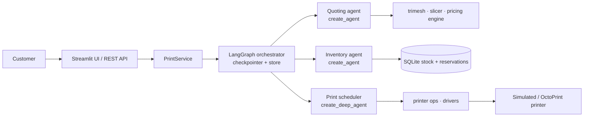
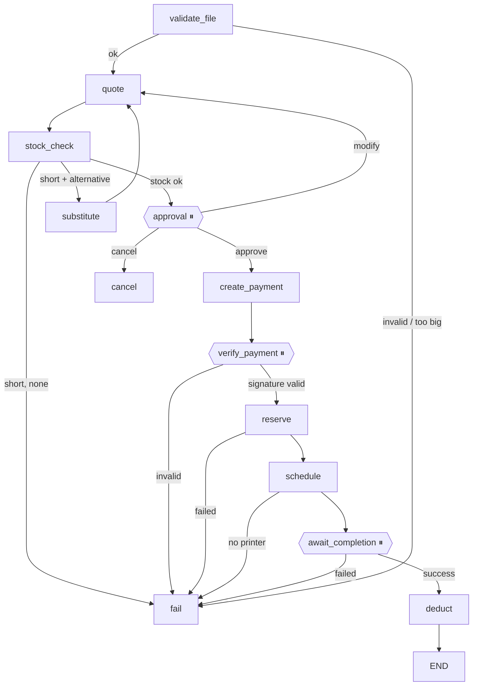

# Architecture

## System

## Workflow graph

⏸ = `interrupt()`; the graph state is checkpointed and resumed with `Command(resume=...)`.
Every `fail` path releases reserved filament and flags `REFUND_REQUIRED` if money was taken.

## Integration contract

All agents share one `PrintJobState` (see `app/graph/state.py`). Agents never call each other: the orchestrator passes
each one a single JSON request, the agent runs its tool loop, and the orchestrator reads **tool results** (not free text)
back into state. If a model skips a required tool, `run_agent` retries once, then the order fails cleanly.

| Step | Writes to state | Read by |
|---|---|---|
| validate_file | `model_analysis`, `config` (may load saved prefs from store) | quote, schedule |
| quote | `quote` (price, weight, minutes, gcode_path), `suggestion` | stock_check, approval, reserve, schedule |
| stock_check | `stock_check` (+ alternatives) | routing, substitute |
| approval | `route`, modified `config` | routing |
| payment | `payment` | reserve, fail |
| reserve | `reservation` | fail (release), deduct |
| schedule | `assignment` | await_completion |
| deduct | `inventory_alerts`; store: preferences, usage | UI, next order |

## Memory

* **Short-term:** `SqliteSaver` checkpointer, `thread_id = order_id`. Survives restarts (tested).
* **Long-term:** `SqliteStore`: `("customers", id)/prefs` (reused to pre-fill the next order) and
  `("inventory","usage")/<material>` (grams consumed per material).

## Scheduling logic

1. Hard filter: printer online, supports the material, part fits the bed (any rotation).
2. Score = queue minutes + changeover penalty (material 20 min, colour 10 min) + run time / printer speed. Lowest wins.
3. `assign_job` claims the printer in one transaction (re-checks it is still online); `dispatch_gcode` sends via the driver.

## Inventory logic

`available = on_hand - reserved`. Reservations are atomic (`BEGIN IMMEDIATE`), so two orders can never take the same
grams (tested). Reserve happens only after verified payment; deduct only after the print succeeds; failures release.
